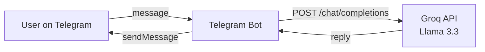

# Linklet AI Support Bot

24/7 AI customer support bot for Linklet on Telegram, powered by Groq (Llama 3.3).

## Why This Exists

Linklet is a campus marketplace where Kenyan university students buy, sell, and trade items. Students often have questions outside business hours. This bot answers them instantly on Telegram — with conversation memory so it remembers context within a chat.

## Status

**Live** — deployed and running 24/7.

*Last updated: November 2026*

## Features

- 24/7 availability on Telegram
- AI responses via Groq (Llama 3.3 70B)
- Conversation memory (last 10 messages per chat)
- Custom system prompt tailored to Linklet's business rules
- Multilingual replies (responds in the user's language)
- Health-check HTTP server for Render's free tier
- Polling mode (no HTTPS/webhook setup needed)

## Planned

- Escalation to human support when AI is unsure
- Order status lookups
- FAQ knowledge base

## Tech Stack

- Node.js
- node-telegram-bot-api
- Groq API (llama-3.3-70b-versatile)
- Axios
- Render (hosting)

## Architecture



## Setup

### Prerequisites

- Node.js 18+
- Telegram Bot Token (from @BotFather)
- Groq API Key

### Install

```powershell
git clone https://github.com/muniko53/linklet-telegram-bot.git
cd linklet-telegram-bot
npm install
```

### Environment Variables

Create a `.env` file:

```env
TELEGRAM_TOKEN=your_telegram_bot_token
GROQ_API_KEY=your_groq_api_key
GROQ_MODEL=llama-3.3-70b-versatile
PORT=3000
```

### Run

```powershell
npm start
```

The bot listens on port 3000 and polls Telegram for messages. Send `/start` to your bot on Telegram to test.

## Limitations

- Uses polling mode, which requires the process to stay running
- Conversation memory is in-memory (resets on restart)
- Rate limits apply based on Groq plan
- Health-check server is minimal (returns plain text)

## License

MIT

## Contact

[Linklet](https://www.linklet.co.ke) · [Portfolio](https://muniko53.github.io/jacob-muniko-portfolio/)